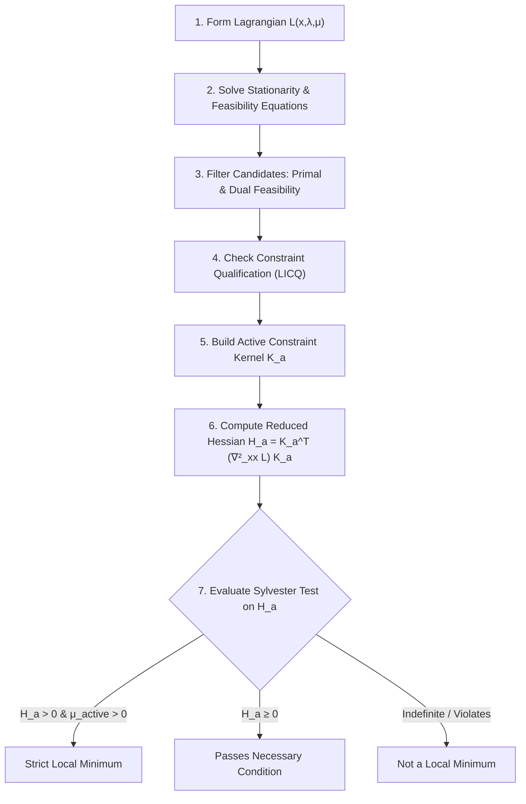

---
tags:
  - BERTOLAZZI
data: 2026-10-06
---

# Questions & Clarifications

### Question 1
> **Q:** In the example, we check the existence of candidates under the hypothesis $x=y=0$. Is the idea for inequality constraints to explore each of the possible active-set configurations (each constraint activated alone or in combination) and then find the candidates in that context? Is each candidate then studied by applying the second-order conditions?

**Answer:** 
**Yes, exactly.** 
1. **Branching / Active-Set Enumeration:** The KKT complementary slackness conditions $\mu_\ell g_\ell(x) = 0$ for $\ell = 1, \dots, p$ state that for every inequality constraint, either the constraint is **active** ($g_\ell(x) = 0$ with multiplier $\mu_\ell \ge 0$) or **inactive** ($g_\ell(x) > 0$ with multiplier $\mu_\ell = 0$). For $p$ inequality constraints, there are $2^p$ possible combinations of active vs. inactive constraints.
2. **Candidate Identification:** For each combination (branch), we solve the resulting system of first-order equations ($\nabla_x \mathcal{L} = 0$, $h_k(x) = 0$, active $g_\ell(x) = 0$, inactive $\mu_\ell = 0$). Any candidate $(x^*, \lambda^*, \mu^*)$ obtained must be checked for **primal feasibility** ($g_\ell(x^*) \ge 0, h_k(x^*) = 0$) and **dual feasibility** ($\mu_\ell^* \ge 0$).
3. **Second-Order Classification:** For every feasible candidate $(x^*, \lambda^*, \mu^*)$ passing the first-order test, we form the Hessian of the Lagrangian $\nabla_{xx}^2 \mathcal{L}(x^*, \lambda^*, \mu^*)$ and project it onto the **kernel of active constraints** (or test it on the **critical cone**). We evaluate necessary conditions (reduced Hessian is semi-positive definite) and sufficient conditions (reduced Hessian is strictly positive definite + strict complementarity $\mu_\ell^* > 0$ for active constraints).

---

# 1. Constrained Minimization & Lagrange Multipliers

> **Sources:**
> - [Lesson 04.pdf](file:///home/max/Documenti/UNI/Magistrale/Numerical%20Optimization%20and%20optimal%20control%20for%20Dynamical%20systems%20-%20BERTOLAZZI/Lesson%2004.pdf) — Bertolazzi, Lesson 4: Constrained Minimization / KKT conditions.
> - [Textbook Chapter 2 & 5](file:///home/max/Documenti/UNI/Magistrale/Numerical%20Optimization%20and%20optimal%20control%20for%20Dynamical%20systems%20-%20BERTOLAZZI/Numerical-optimization-and-optimal-control-for-dynamical-systems-%5B146442%5D%201.pdf) — Bertolazzi, *Numerical Optimization and Optimal Control for Dynamical Systems*.

## 1.1 Non-Linear Programming (NLP) Problem Formulation

A general Non-Linear Programming (NLP) problem with equality and inequality constraints is defined as:

$$
\begin{cases}
\text{minimize} & f(x), & f: \mathbb{R}^n \to \mathbb{R} \\
\text{subject to} & h_k(x) = 0, & h_k: \mathbb{R}^n \to \mathbb{R}, \quad k = 1, 2, \dots, m \\
& g_\ell(x) \ge 0, & g_\ell: \mathbb{R}^n \to \mathbb{R}, \quad \ell = 1, 2, \dots, p
\end{cases}
$$

### Regularity Assumptions
- **First-Order Regularity ($C^1$):** $f, h_k, g_\ell \in C^1(\mathbb{R}^n)$ with Lipschitz continuous gradients.
- **Second-Order Regularity ($C^2$):** $f, h_k, g_\ell \in C^2(\mathbb{R}^n)$ with Lipschitz continuous Hessian matrices.

### Feasible Region
The set of feasible points is defined as:
$$
\mathcal{F} = \left\{ x \in \mathbb{R}^n \;|\; h_k(x) = 0 \quad (k=1,\dots,m), \quad g_\ell(x) \ge 0 \quad (\ell=1,\dots,p) \right\}
$$

---

## 1.2 Equality Constraints & Standard Lagrange Multipliers

When only equality constraints are present ($m \ge 1, p = 0$):

$$
\begin{matrix}
\text{minimize} & f(x) \\
\text{subject to} & h_k(x) = 0, \quad k=1,\dots,m
\end{matrix}
$$

We define the **Lagrangian function**:
$$
\mathcal{L}(x, \lambda) = f(x) - \sum_{k=1}^m \lambda_k h_k(x)
$$

### First-Order Necessary Condition for Equality Constraints
To find candidate local minima, we set the gradient of $\mathcal{L}$ with respect to all variables $(x, \lambda)$ to zero:

$$
\begin{cases}
\frac{\partial \mathcal{L}(x, \lambda)}{\partial x} = \nabla f(x) - \sum_{k=1}^m \lambda_k \nabla h_k(x) = 0^T \\
-\frac{\partial \mathcal{L}(x, \lambda)}{\partial \lambda_k} = h_k(x) = 0, \quad k=1,\dots,m
\end{cases}
$$

Solving this system gives candidate stationary points $(x^*, \lambda^*)$.

---

## 1.3 Second-Order Conditions for Equality Constraints

The Hessian of the Lagrangian with respect to $x$ only is:
$$
\nabla_{xx}^2 \mathcal{L}(x, \lambda) = \nabla^2 f(x) - \sum_{k=1}^m \lambda_k \nabla^2 h_k(x) \quad \in \mathbb{R}^{n \times n}
$$

### Summary Table of Optimality Conditions

| Condition | Mathematical Meaning | Result |
| :--- | :--- | :--- |
| **Necessary** | If **false** $\Rightarrow$ point is **NOT** a local minimum | Required for minimum |
| **Sufficient** | If **true** $\Rightarrow$ point **IS** a local minimum | Guarantees minimum |
| **Gray Zone** | Necessary is **true**, but Sufficient is **false** | Inconclusive (requires higher-order analysis) |

---

## 1.4 Kernel Projection & Reduced Hessian

Let $\nabla h(x^*) \in \mathbb{R}^{m \times n}$ be the Jacobian matrix of the constraints at candidate point $x^*$:

$$
\nabla h(x^*) = \begin{pmatrix} \nabla h_1(x^*) \\ \nabla h_2(x^*) \\ \vdots \\ \nabla h_m(x^*) \end{pmatrix}_{m \times n}
$$

### Step 1: Find the Kernel Base Matrix $K$
The kernel (null space) of the constraint Jacobian at $x^*$ is:
$$
\ker\left( \nabla h(x^*) \right) = \left\{ z \in \mathbb{R}^n \;|\; \nabla h(x^*) z = 0 \right\}
$$
We express any vector $z \in \ker\left( \nabla h(x^*) \right)$ using a kernel basis matrix $K \in \mathbb{R}^{n \times (n-m)}$:
$$
z = K \alpha, \quad \text{where } \alpha \in \mathbb{R}^{n-m} \quad \text{and} \quad \nabla h(x^*) K = 0_{m \times (n-m)}
$$

### Step 2: Compute the Reduced Hessian $C$
Project the full Lagrangian Hessian $\nabla_{xx}^2 \mathcal{L}(x^*, \lambda^*)$ onto the kernel space:
$$
C = K^T \, \nabla_{xx}^2 \mathcal{L}(x^*, \lambda^*) \, K \quad \in \mathbb{R}^{(n-m) \times (n-m)}
$$

### Step 3: Second-Order Tests
- **Sufficient Condition:** $C$ is **Symmetric Positive Definite (SPD)** ($C > 0$) $\Rightarrow$ $(x^*, \lambda^*)$ is a **strict local minimum**.
- **Necessary Condition:** $C$ is **Semi-SPD** ($C \ge 0$) $\Rightarrow$ necessary condition for a local minimum holds.

---

# 2. Transforming NLP $\rightarrow$ Lagrange Problem (Slack Variable Method)

Any inequality constraint $g_\ell(x) \ge 0$ can be converted into an equality constraint by introducing a squared slack variable $y_\ell^2 \ge 0$:
$$
g_\ell(x) \ge 0 \iff g_\ell(x) - y_\ell^2 = 0, \quad y_\ell \in \mathbb{R}
$$

## 2.1 Reformulated Constraint Vector

We define the extended state $z = \begin{pmatrix} x \\ y \end{pmatrix} \in \mathbb{R}^{n+p}$ and the extended equality constraint map $H(x,y)$:

$$
H(x,y) = \begin{pmatrix}
h_1(x) \\ \vdots \\ h_m(x) \\
g_1(x) - y_1^2 \\ \vdots \\ g_p(x) - y_p^2
\end{pmatrix} = 0_{m+p}, \qquad F(x,y) = f(x)
$$

The extended Lagrangian becomes:
$$
\mathcal{L}_e(x, y, \lambda, \mu) = f(x) - \sum_{k=1}^m \lambda_k h_k(x) - \sum_{\ell=1}^p \mu_\ell \left( g_\ell(x) - y_\ell^2 \right)
$$

## 2.2 First-Order Stationarity of Extended Lagrangian
Setting $\nabla_{(x,y,\lambda,\mu)} \mathcal{L}_e = 0$:

1. $\nabla_x \mathcal{L}_e = \nabla f(x) - \sum_{k=1}^m \lambda_k \nabla h_k(x) - \sum_{\ell=1}^p \mu_\ell \nabla g_\ell(x) = 0^T$
2. $\nabla_{y_\ell} \mathcal{L}_e = 2 \mu_\ell y_\ell = 0 \implies \mu_\ell y_\ell = 0$
3. $h_k(x) = 0$ for $k=1,\dots,m$
4. $g_\ell(x) = y_\ell^2 \ge 0$ for $\ell=1,\dots,p$

> **Key Insight:** The condition $2\mu_\ell y_\ell = 0$ together with $y_\ell^2 = g_\ell(x)$ recovers the exact KKT **complementary slackness** condition:
> $$ \mu_\ell g_\ell(x) = 0 $$
> The trade-off of this method is adding $p$ extra variables and working with an extended Hessian that is no longer globally positive definite.

---

# 3. Worked Example (Step-by-Step Comparison)

Consider the linear optimization problem:
$$
\min_{x,y} \; f(x,y) = x + 2y \qquad \text{s.t.} \quad g_1(x,y) = x \ge 0, \quad g_2(x,y) = y \ge 0, \quad g_3(x,y) = 1 - x - y \ge 0
$$

---

## Method 1 — Squared Variables (Equality Reformulation)

We set:
$$
H(x,y,\alpha,\beta,\sigma) = \begin{pmatrix} x - \alpha^2 \\ y - \beta^2 \\ 1 - x - y - \sigma^2 \end{pmatrix} = 0
$$

The extended Lagrangian is:
$$
\mathcal{L} = x + 2y - \lambda_1 (x - \alpha^2) - \lambda_2 (y - \beta^2) - \lambda_3 (1 - x - y - \sigma^2)
$$

### Stationarity Equations $\nabla \mathcal{L} = 0$:
$$
\begin{cases}
\partial_x \mathcal{L} = 1 - \lambda_1 + \lambda_3 = 0 \\
\partial_y \mathcal{L} = 2 - \lambda_2 + \lambda_3 = 0 \\
\partial_\alpha \mathcal{L} = 2 \lambda_1 \alpha = 0 \\
\partial_\beta \mathcal{L} = 2 \lambda_2 \beta = 0 \\
\partial_\sigma \mathcal{L} = 2 \lambda_3 \sigma = 0 \\
x - \alpha^2 = 0, \quad y - \beta^2 = 0, \quad 1 - x - y - \sigma^2 = 0
\end{cases}
$$

### Solving the Candidate System:
- Testing $x = y = 0 \implies \alpha = 0, \beta = 0$.
- $1 - 0 - 0 - \sigma^2 = 0 \implies \sigma^2 = 1 \implies \sigma = \pm 1$.
- From $2\lambda_3 \sigma = 0$ with $\sigma = \pm 1 \implies \mathbf{\lambda_3 = 0}$.
- From $1 - \lambda_1 + 0 = 0 \implies \mathbf{\lambda_1 = 1}$.
- From $2 - \lambda_2 + 0 = 0 \implies \mathbf{\lambda_2 = 2}$.

Candidate point: $(x^*, y^*, \alpha^*, \beta^*, \sigma^*) = (0, 0, 0, 0, 1)$ with multipliers $(\lambda_1, \lambda_2, \lambda_3) = (1, 2, 0)$.

### Extended Hessian Matrix w.r.t. $z = (x, y, \alpha, \beta, \sigma)$:
$$
\nabla_{zz}^2 \mathcal{L} = \begin{pmatrix}
0 & 0 & 0 & 0 & 0 \\
0 & 0 & 0 & 0 & 0 \\
0 & 0 & 2\lambda_1 & 0 & 0 \\
0 & 0 & 0 & 2\lambda_2 & 0 \\
0 & 0 & 0 & 0 & -2\lambda_3
\end{pmatrix}
= \operatorname{diag}(0, \; 0, \; 2(1), \; 2(2), \; -2(0)) = \operatorname{diag}(0, 0, 2, 4, 0)
$$

### Constraint Jacobian Matrix $\nabla H(z^*)$:
$$
\nabla H(z^*) = \begin{pmatrix}
1 & 0 & -2\alpha & 0 & 0 \\
0 & 1 & 0 & -2\beta & 0 \\
-1 & -1 & 0 & 0 & -2\sigma
\end{pmatrix}
= \begin{pmatrix}
1 & 0 & 0 & 0 & 0 \\
0 & 1 & 0 & 0 & 0 \\
-1 & -1 & 0 & 0 & -2
\end{pmatrix}
$$

### Kernel of Constraint Jacobian:
Solving $\nabla H(z^*) z = 0$:
$$
\begin{cases}
z_1 = 0 \\
z_2 = 0 \\
-z_1 - z_2 - 2 z_5 = 0 \implies z_5 = 0
\end{cases}
\implies z_3, z_4 \text{ are free variables.}
$$
Kernel basis matrix $K$:
$$
K = \begin{pmatrix}
0 & 0 \\
0 & 0 \\
1 & 0 \\
0 & 1 \\
0 & 0
\end{pmatrix}_{5 \times 2}
$$

### Reduced Hessian Calculation:
$$
C = K^T \left( \nabla_{zz}^2 \mathcal{L} \right) K = \begin{pmatrix}
1 & 0 & 0 & 0 & 0 \\
0 & 0 & 1 & 0 & 0
\end{pmatrix}
\begin{pmatrix}
0 & 0 & 0 & 0 & 0 \\
0 & 0 & 0 & 0 & 0 \\
0 & 0 & 2 & 0 & 0 \\
0 & 0 & 0 & 4 & 0 \\
0 & 0 & 0 & 0 & 0
\end{pmatrix}
\begin{pmatrix}
0 & 0 \\
0 & 0 \\
1 & 0 \\
0 & 1 \\
0 & 0
\end{pmatrix}
= \begin{pmatrix} 2 & 0 \\ 0 & 4 \end{pmatrix}
$$

Applying Sylvester's Criterion:
- Principal minor 1: $\Delta_1 = 2 > 0$
- Principal minor 2: $\Delta_2 = 8 > 0$

Since $C$ is **SPD**, the **sufficient condition holds**, confirming $(0,0)$ is a **strict local minimum** with minimum value $f^* = 0$.

---

## Method 2 — KKT Direct Analysis

Lagrangian:
$$
\mathcal{L}(x, y, \mu) = x + 2y - \mu_1 x - \mu_2 y - \mu_3 (1 - x - y)
$$

### KKT First-Order Conditions:
$$
\begin{cases}
\text{Stationarity:} & 1 - \mu_1 + \mu_3 = 0, \quad 2 - \mu_2 + \mu_3 = 0 \\
\text{Primal Feasibility:} & x \ge 0, \quad y \ge 0, \quad 1 - x - y \ge 0 \\
\text{Dual Feasibility:} & \mu_1 \ge 0, \quad \mu_2 \ge 0, \quad \mu_3 \ge 0 \\
\text{Complementarity:} & \mu_1 x = 0, \quad \mu_2 y = 0, \quad \mu_3 (1 - x - y) = 0
\end{cases}
$$

### Active-Set Branch Analysis ($2^3 = 8$ Cases):
1. **Branch $\mu_3 > 0$ (Boundary $g_3 = 0 \implies 1-x-y=0$):**
   - If $x>0, y>0 \implies \mu_1=0, \mu_2=0 \implies 1+\mu_3=0 \implies \mu_3=-1<0$ (contradiction with dual feasibility).
   - If $x=0, y=0 \implies 1-0-0 = 1 \ne 0 \implies g_3$ cannot be active (contradiction).
2. **Branch $\mu_3 = 0$ (Interior of $g_3 > 0$):**
   - Stationarity becomes: $1 - \mu_1 + 0 = 0 \implies \mathbf{\mu_1 = 1}$, and $2 - \mu_2 + 0 = 0 \implies \mathbf{\mu_2 = 2}$.
   - Dual feasibility check: $\mu_1 = 1 \ge 0$, $\mu_2 = 2 \ge 0$ $\checkmark$.
   - Complementarity: $\mu_1 x = 0 \implies 1 \cdot x = 0 \implies \mathbf{x = 0}$.
   - Complementarity: $\mu_2 y = 0 \implies 2 \cdot y = 0 \implies \mathbf{y = 0}$.
   - Primal feasibility: $g_3(0,0) = 1 - 0 - 0 = 1 \ge 0$ $\checkmark$.

Thus, $(x^*, y^*) = (0,0)$ with multipliers $\mu^* = (1, 2, 0)$ is the **unique KKT stationary point**.

### Active-Set Shortcut & Reduced Hessian:
At $(0,0)$:
- Active constraints: $g_1(0,0) = 0$ (strongly active since $\mu_1 = 1 > 0$), $g_2(0,0) = 0$ (strongly active since $\mu_2 = 2 > 0$).
- Inactive constraint: $g_3(0,0) = 1 > 0$ ($\mu_3 = 0$).
- Gradients of active constraints: $\nabla g_1 = (1, 0)$, $\nabla g_2 = (0, 1)$.
- Active Jacobian matrix: $J_{\mathcal{A}} = \begin{pmatrix} 1 & 0 \\ 0 & 1 \end{pmatrix}$.
- Kernel of active constraints: $\ker(J_{\mathcal{A}}) = \{ (0,0)^T \}$ (dimension 0).
- Since the kernel is zero-dimensional, the reduced Hessian is a $0 \times 0$ matrix.
- **Conclusion:** The necessary condition is trivially satisfied ($0 \ge 0$). The sufficient condition is satisfied because all active constraints are strictly active ($\mu_1 > 0, \mu_2 > 0$), leaving no non-zero critical direction to test.

---

# 4. KKT Conditions (First Order) & Constraint Qualifications

For a general non-linear programming problem:
$$
\begin{matrix}
\text{minimize} & f(x) \\
\text{subject to} & h_k(x) = 0 & (k=1,\dots,m) \\
& g_\ell(x) \ge 0 & (\ell=1,\dots,p)
\end{matrix}
$$

We define the standard KKT Lagrangian:
$$
\mathcal{L}(x, \lambda, \mu) = f(x) - \sum_{k=1}^m \lambda_k h_k(x) - \sum_{\ell=1}^p \mu_\ell g_\ell(x)
$$

## 4.1 First-Order KKT Conditions

A point $(x^*, \lambda^*, \mu^*)$ is a **KKT (stationary) point** if it satisfies the following 5 conditions:

$$
\boxed{
\begin{aligned}
&\nabla_x \mathcal{L}(x^*, \lambda^*, \mu^*) = 0^T && \text{(1. Stationarity)} \\
&h_k(x^*) = 0, \quad \forall k=1,\dots,m && \text{(2. Equality Constraints)} \\
&g_\ell(x^*) \ge 0, \quad \forall \ell=1,\dots,p && \text{(3. Primal Feasibility)} \\
&\mu_\ell^* \ge 0, \quad \forall \ell=1,\dots,p && \text{(4. Dual Feasibility)} \\
&\mu_\ell^* \, g_\ell(x^*) = 0, \quad \forall \ell=1,\dots,p && \text{(5. Complementary Slackness)}
\end{aligned}
}
$$

---

## 4.2 Active Set Definitions & Partitioning

The **active set** $\mathcal{A}(x^*)$ contains the indices of inequality constraints that hold with equality at $x^*$:
$$
\mathcal{A}(x^*) = \left\{ \ell \in \{1,\dots,p\} \;|\; g_\ell(x^*) = 0 \right\}
$$

The active set is further partitioned into:
1. **Strongly Active Constraints:** $\mathcal{A}^+(x^*, \mu^*) = \left\{ \ell \in \mathcal{A}(x^*) \;|\; \mu_\ell^* > 0 \right\}$
2. **Weakly Active Constraints:** $\mathcal{A}^0(x^*, \mu^*) = \left\{ \ell \in \mathcal{A}(x^*) \;|\; \mu_\ell^* = 0 \right\}$

Note that:
$$
\mathcal{A}^+(x^*, \mu^*) \cap \mathcal{A}^0(x^*, \mu^*) = \emptyset, \qquad \mathcal{A}^+(x^*, \mu^*) \cup \mathcal{A}^0(x^*, \mu^*) = \mathcal{A}(x^*)
$$

---

## 4.3 Constraint Qualifications (CQ)

The first-order KKT necessary conditions hold at a local minimum $x^*$ **provided that a Constraint Qualification (CQ) holds** at $x^*$.

### Linear Independence Constraint Qualification (LICQ)
$x^*$ satisfies **LICQ** if the gradients of all equality constraints and all active inequality constraints at $x^*$ are linearly independent:

$$
\left\{ \nabla h_1(x^*), \dots, \nabla h_m(x^*) \right\} \cup \left\{ \nabla g_\ell(x^*) \;|\; \ell \in \mathcal{A}(x^*) \right\} \quad \text{are linearly independent.}
$$

### What Happens Without LICQ? (Fritz John Theorem)
If LICQ fails, a local minimum $x^*$ might not satisfy standard KKT equations. Instead, it satisfies the **Fritz John necessary conditions**, which introduce an additional multiplier $\mu_0^* \ge 0$ for the objective function:

$$
\mu_0^* \nabla f(x^*) - \sum_{k=1}^m \lambda_k^* \nabla h_k(x^*) - \sum_{\ell=1}^p \mu_\ell^* \nabla g_\ell(x^*) = 0^T, \quad (\mu_0^*, \lambda^*, \mu^*) \ne 0
$$

When LICQ holds, $\mu_0^* > 0$ is guaranteed, allowing us to normalize $\mu_0^* = 1$ and obtain the standard KKT system.

---

# 5. Second-Order Conditions & Critical Cone

Let $M = \nabla_{xx}^2 \mathcal{L}(x^*, \lambda^*, \mu^*)$ be the Hessian of the Lagrangian with respect to $x$:
$$
M = \nabla^2 f(x^*) - \sum_{k=1}^m \lambda_k^* \nabla^2 h_k(x^*) - \sum_{\ell=1}^p \mu_\ell^* \nabla^2 g_\ell(x^*)
$$

## 5.1 The Critical Cone $\mathcal{C}(x^*, \mu^*)$

The **critical cone** contains all linearized directions $d \in \mathbb{R}^n$ along which the objective function value does not strictly increase to first order:

$$
\mathcal{C}(x^*, \mu^*) = \left\{ d \in \mathbb{R}^n \; \middle| \;
\begin{aligned}
\nabla h_k(x^*) d = 0, &\quad \forall k = 1, \dots, m \\
\nabla g_\ell(x^*) d = 0, &\quad \forall \ell \in \mathcal{A}^+(x^*, \mu^*) \\
\nabla g_\ell(x^*) d \ge 0, &\quad \forall \ell \in \mathcal{A}^0(x^*, \mu^*)
\end{aligned}
\right\}
$$

---

## 5.2 Second-Order Necessary Condition (Textbook Lemma 5.2)

If $x^*$ is a local minimum of the NLP and LICQ holds, then the Hessian of the Lagrangian is semi-positive definite on the critical cone:

$$
d^T M d \ge 0, \quad \forall d \in \mathcal{C}(x^*, \mu^*)
$$

Equivalently, the reduced Hessian matrix $H_a = K_a^T M K_a$ must be **semi-positive definite** ($H_a \ge 0$), where $K_a$ is the basis matrix for the kernel of active constraints $\ker \begin{pmatrix} \nabla h(x^*) \\ \nabla g_{\mathcal{A}}(x^*) \end{pmatrix}$.

---

## 5.3 Second-Order Sufficient Condition (Textbook Lemma 5.3)

Suppose $(x^*, \lambda^*, \mu^*)$ is a KKT point satisfying:
1. $d^T M d > 0$ for all non-zero directions $d \in \mathcal{C}(x^*, \mu^*), d \ne 0$ (i.e., reduced Hessian $H_a > 0$ is strictly positive definite).
2. **Strict Complementarity:** $\mu_\ell^* > 0$ for all active constraints $\ell \in \mathcal{A}(x^*)$ (so $\mathcal{A}^0(x^*, \mu^*) = \emptyset$).

Then $x^*$ is a **strict local minimum** of the NLP.

---

# 6. Sylvester's Theorem & The Perturbation Trick for Semi-Definite Matrices

> **Source:** [Textbook Chapter 3](file:///home/max/Documenti/UNI/Magistrale/Numerical%20Optimization%20and%20optimal%20control/Numerical-optimization-and-optimal-control-for-dynamical-systems-%5B146442%5D%201.pdf) — Bertolazzi, *Sylvester Theorem and Perturbation Trick*.

## 6.1 Classical Sylvester Theorem (Strictly Positive Definite)

A real symmetric matrix $A \in \mathbb{R}^{n \times n}$ is **Symmetric Positive Definite (SPD)** ($A > 0$) if and only if all its leading principal minors are strictly positive:

$$
A_k = \det\left( \text{submatrix of } A \text{ formed by first } k \text{ rows and columns} \right) > 0, \quad \forall k = 1, 2, \dots, n
$$

---

## 6.2 Sylvester's Trick for Semi-Positive Definite Matrices (Lemma 3.1)

Standard Sylvester theorem **cannot** directly classify semi-positive definite matrices when a principal minor $A_k = 0$.

### Lemma 3.1 (Sylvester Perturbation Trick)
A symmetric matrix $A \in \mathbb{R}^{n \times n}$ is **semi-positive definite** ($A \ge 0$) if and only if all its leading principal minors $A_k$ satisfy:
1. $\det(A_k) > 0$, **OR**
2. $\det(A_k) = 0$ **AND** the derivative of the perturbed determinant at $\varepsilon = 0^+$ is strictly positive:
$$
\left. \frac{d}{d\varepsilon} \det\left( A_k + \varepsilon I \right) \right|_{\varepsilon = 0^+} > 0
$$

---

## 6.3 Worked Examples of Sylvester's Trick

### Example A: Testing Semi-Definiteness of $A = \begin{pmatrix} 1 & 2 \\ 2 & 4 \end{pmatrix}$
1. Minor 1: $\det(A_1) = \det[1] = 1 > 0$ $\checkmark$.
2. Minor 2: $\det(A_2) = \det \begin{pmatrix} 1 & 2 \\ 2 & 4 \end{pmatrix} = 4 - 4 = 0$ (inconclusive by standard Sylvester).
3. **Perturbation Test:** 
   $$
   p(\varepsilon) = \det(A + \varepsilon I) = \det \begin{pmatrix} 1+\varepsilon & 2 \\ 2 & 4+\varepsilon \end{pmatrix} = (1+\varepsilon)(4+\varepsilon) - 4 = 5\varepsilon + \varepsilon^2
   $$
4. **Derivative at $\varepsilon=0$:**
   $$
   \left. \frac{d}{d\varepsilon} p(\varepsilon) \right|_{\varepsilon=0} = \left. (5 + 2\varepsilon) \right|_{\varepsilon=0} = 5 > 0
   $$
5. **Conclusion:** Matrix $A$ is **semi-positive definite** ($A \ge 0$). (Eigenvalues are $\lambda_1 = 0, \lambda_2 = 5$).

---

### Counter-Example B: Testing Matrix $A = \begin{pmatrix} 1 & 1 & 1 \\ 1 & 1 & 1 \\ 1 & 1 & 0 \end{pmatrix}$
1. Minor 1: $\det(A_1) = 1 > 0$.
2. Minor 2: $\det(A_2) = \det \begin{pmatrix} 1 & 1 \\ 1 & 1 \end{pmatrix} = 0$.
   - Perturbed 2x2 minor: $\det \begin{pmatrix} 1+\varepsilon & 1 \\ 1 & 1+\varepsilon \end{pmatrix} = \varepsilon^2 + 2\varepsilon > 0$ for $\varepsilon > 0$.
3. Minor 3: $\det(A_3) = \det(A) = 0$.
   - Perturbed 3x3 matrix determinant:
     $$
     p(\varepsilon) = \det(A + \varepsilon I) = \det \begin{pmatrix} 1+\varepsilon & 1 & 1 \\ 1 & 1+\varepsilon & 1 \\ 1 & 1 & \varepsilon \end{pmatrix} = \varepsilon^3 + 2\varepsilon^2 - 2\varepsilon
     $$
4. **Derivative at $\varepsilon=0$:**
   $$
   p'(0) = \left. (3\varepsilon^2 + 4\varepsilon - 2) \right|_{\varepsilon=0} = -2 < 0
   $$
5. **Conclusion:** Matrix $A$ is **NOT semi-positive definite** (it is indefinite). (Eigenvalues are $\lambda_1 = 0, \lambda_2 = 1+\sqrt{3} \approx 2.73, \lambda_3 = 1-\sqrt{3} \approx -0.73$).

---

# 7. Step-by-Step Practical Algorithm for Solving NLP Problems

When solving a general constrained optimization problem:

$$
\begin{matrix}
\text{minimize} & f(x) \\
\text{subject to} & h_k(x) = 0 & (k=1,\dots,m) \\
& g_\ell(x) \ge 0 & (\ell=1,\dots,p)
\end{matrix}
$$

Follow this systematic 6-step roadmap:

1. **Form the Lagrangian Function:**
   $$ \mathcal{L}(x, \lambda, \mu) = f(x) - \sum_{k=1}^m \lambda_k h_k(x) - \sum_{\ell=1}^p \mu_\ell g_\ell(x) $$

2. **Solve the First-Order System:**
   $$ \nabla_x \mathcal{L}(x, \lambda, \mu) = 0^T, \qquad h_k(x) = 0, \qquad \mu_\ell g_\ell(x) = 0 $$
   *(Use active-set branching across all $2^p$ combinations of $g_\ell(x) = 0$ vs. $\mu_\ell = 0$).*

3. **Filter Valid Candidates:**
   Discard any solution $(x^*, \lambda^*, \mu^*)$ violating primal feasibility ($g_\ell(x^*) < 0$) or dual feasibility ($\mu_\ell^* < 0$).

4. **Verify Constraint Qualification (LICQ):**
   Check that $\{\nabla h_k(x^*)\} \cup \{\nabla g_\ell(x^*) : \ell \in \mathcal{A}(x^*)\}$ are linearly independent.

5. **Construct Active Kernel Basis Matrix $K_a$:**
   Find the basis for $\ker \begin{pmatrix} \nabla h(x^*) \\ \nabla g_{\mathcal{A}}(x^*) \end{pmatrix}$.

6. **Evaluate Reduced Hessian:**
   Compute $H_a = K_a^T \, \nabla_{xx}^2 \mathcal{L}(x^*, \lambda^*, \mu^*) \, K_a$.
   - **Sufficient Test:** If $H_a$ is strictly positive definite ($H_a > 0$ via Sylvester) and $\mu_\ell^* > 0$ for all active constraints, $x^*$ is a **strict local minimum**.
   - **Necessary Test:** If $H_a$ is semi-positive definite ($H_a \ge 0$ via Sylvester perturbation trick), necessary conditions are satisfied.
